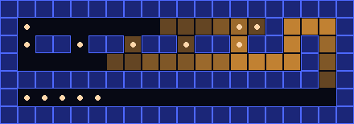
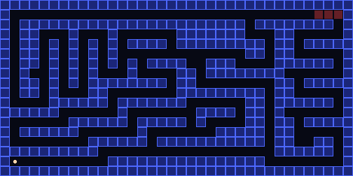
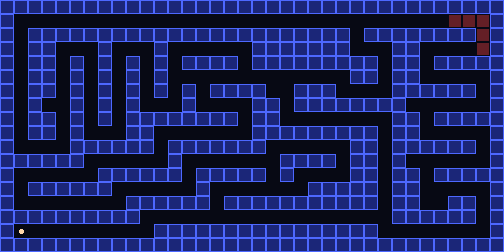
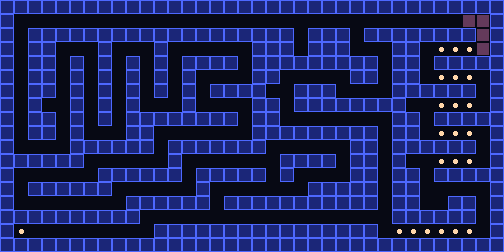
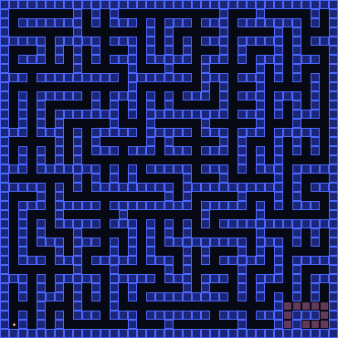
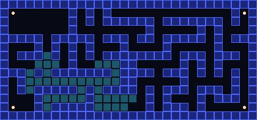
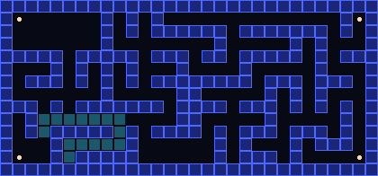

# Search Algorithms in Pac-Man

**SE3062 Intelligent Systems · Group assignment (10%) · Group_XX**

We taught Pac-Man to find his way through mazes. We wrote four search algorithms (DFS, BFS, UCS, A*) and two heuristics, for touching all four corners and for eating every dot.

- **Autograder:** all 7 questions pass, **40/40** by the course's marking scheme
- **Presentation website:** open [`Presentation/index.html`](Presentation/index.html) in a browser. It's dark themed, with animated replays and code for every question. Press ← / → to move between sections.



---

## 1. What the assignment asked

- Use the UC Berkeley Pac-Man code (`search.zip`).
- Edit **only** two files:
  - `search.py`: Q1–Q4 (the search algorithms)
  - `searchAgents.py`: Q5–Q7 (the problems and heuristics)
- Use `util.Stack`, `util.Queue` and `util.PriorityQueue`, not Python built-ins.
- Use **graph search**: never expand the same state twice.
- Don't rename any file, function or class. The autograder finds them by name.
- Heuristics must be **admissible** (never guess too high) and **consistent**. A wrong heuristic gets 0 marks.
- Everyone must understand **all** of the code, because the viva is individual.

**Marks (100 = 10% of the module)**

| Part | Marks | Who it's for |
|---|---|---|
| Autograder Q1–Q7 | 40 | Group |
| Report | 10 | Group |
| Git commits | 10 | Each person |
| Viva (6 min) | 40 | Each person |

**What we hand in**
- `Group_XX_Report.pdf`: for each question, the code we changed, an autograder screenshot and a short explanation (≤200 words). At the end: the Git link, commit screenshots, the contribution table and the AI declaration.
- `Group_XX_Code.zip`: only `search.py` and `searchAgents.py`.

## 2. What we did vs. what's left

**Done ✅**
- Q1–Q4: DFS, BFS, UCS and A* in `search.py`. All pass.
- Q5–Q6: `CornersProblem` and `cornersHeuristic`. Pass, with 741 nodes expanded (full marks needs ≤ 1200).
- Q7: `foodHeuristic`. Passes, with 4137 nodes expanded (full marks needs ≤ 9000).
- Used only `util` data structures and renamed nothing.
- Autograder output saved in `Group_Project/autograder_logs/`.
- Report with all 9 sections in `Report/`, and the code zip in `Submission/` (it holds only the two edited files).

**Still to do ⏳**
- Replace `Group_XX` with our real group number (report title, PDF name, zip name).
- Replace "Member1–4" with real names and student IDs.
- Add the GitHub link (https://github.com/Iron-voldy/IA_Assignment) to report section 5.
- Each member pushes **their own** commits. Git marks are per person, and the repo has only 1 commit so far.
- Add commit-history screenshots to report section 6.

## 3. Who did what

| Member | Questions | Functions edited | Result | Reviews |
|---|---|---|---|---|
| 🔴 Member 1 | Q1, Q2 | `depthFirstSearch`, `breadthFirstSearch` | 4/4, 4/4 | Member 2's PR |
| 🩷 Member 2 | Q3, Q4 | `uniformCostSearch`, `aStarSearch` | 4/4, 4/4 | Member 3's PR |
| 🔵 Member 3 | Q5, Q6 | `CornersProblem`, `cornersHeuristic` | 8/8, 8/8 | Member 4's PR |
| 🟠 Member 4 | Q7 + lead | `foodHeuristic`, report, zip | 8/8 | Member 1's PR |

**Member 1: DFS and BFS**
- Wrote DFS, which goes as deep as it can first.
- Wrote BFS, which checks the closest places first.
- Built the search "skeleton" that every later question reuses.

**Member 2: UCS and A\***
- Wrote UCS, which always opens the cheapest path found so far.
- Wrote A*, which uses the cost so far **plus** a guess of the cost still to go.
- Tested A* with Manhattan distance on bigMaze: 549 nodes, against 620 for UCS.

**Member 3: Corners problem and heuristic**
- Designed the state: Pac-Man's position + 4 yes/no flags, one per corner.
- Wrote the goal test and the moves.
- Wrote a heuristic: the shortest tour of the remaining corners, ignoring walls.

**Member 4: Food heuristic (and team lead)**
- Wrote the food heuristic: the real maze distance to the farthest dot.
- Saved (cached) distances so each one is worked out only once.
- Merged everyone's code and built the report and the submission zip.

**How the parts fit:** Member 1's loop → Member 2 changes what comes out of the fringe first (UCS, then A*) → Member 3's corners problem runs on BFS and A* → Member 4's heuristic runs on A* and uses BFS for maze distance.

## 4. The one idea behind Q1–Q4

All four algorithms run the same loop. Only the **fringe** (the to-do list) changes.

1. Put the start on the fringe.
2. Take one node out. If it's the goal, return its path.
3. If it hasn't been expanded yet, mark it expanded and add its neighbours.
4. Repeat until the fringe is empty.

| Algorithm | Fringe | Takes out first |
|---|---|---|
| DFS | `util.Stack` | the newest node (dives deep) |
| BFS | `util.Queue` | the oldest node (ring by ring) |
| UCS | `util.PriorityQueue`, priority `g` | the cheapest cost so far |
| A* | `util.PriorityQueue`, priority `g + h` | cost so far + guess of cost left |

## 5. Question by question

Each GIF replays **our real code**. Tinted squares are the places the search looked at, in the real order. The yellow line is the path it returned.

### Q1: Depth First Search (Member 1)
- A **stack** of (place, path). The newest entry comes out first.
- The `expanded` set stops loops.
- Finds *a* path, not always the shortest: 130 steps, 146 nodes.

```python
fringe = util.Stack()
fringe.push((problem.getStartState(), []))
expanded = set()
while not fringe.isEmpty():
    state, path = fringe.pop()
    if problem.isGoalState(state):
        return path
    if state not in expanded:
        expanded.add(state)
        for successor, action, _ in problem.getSuccessors(state):
            if successor not in expanded:
                fringe.push((successor, path + [action]))
return []
```


### Q2: Breadth First Search (Member 1)
- The same code as DFS, but with `util.Queue()`. The oldest entry comes out first.
- Every step costs 1, so BFS finds the **shortest** path: 68 steps, 269 nodes.



### Q3: Uniform Cost Search (Member 2)
- A **priority queue** ordered by the total cost so far, `g`.
- Test for the goal when a node is **taken out**, so nothing cheaper is left.
- In the replay, the east side is cheap, so Pac-Man hugs the right side.

```python
fringe = util.PriorityQueue()
fringe.push((problem.getStartState(), [], 0), 0)
expanded = set()
while not fringe.isEmpty():
    state, path, cost = fringe.pop()
    if problem.isGoalState(state):
        return path
    if state not in expanded:
        expanded.add(state)
        for successor, action, stepCost in problem.getSuccessors(state):
            if successor not in expanded:
                newCost = cost + stepCost
                fringe.push((successor, path + [action], newCost), newCost)
return []
```


### Q4: A* Search (Member 2)
- The same as UCS, but the priority is **g + h** (cost so far + guess of cost left).
- With `nullHeuristic` (h = 0) it's exactly UCS.
- On bigMaze: the same 210-step path, but 549 nodes instead of 620.

```python
start = problem.getStartState()
fringe = util.PriorityQueue()
fringe.push((start, [], 0), heuristic(start, problem))
expanded = set()
while not fringe.isEmpty():
    state, path, cost = fringe.pop()
    if problem.isGoalState(state):
        return path
    if state not in expanded:
        expanded.add(state)
        for successor, action, stepCost in problem.getSuccessors(state):
            if successor not in expanded:
                newCost = cost + stepCost
                fringe.push((successor, path + [action], newCost),
                            newCost + heuristic(successor, problem))
return []
```


### Q5: Finding All the Corners (Member 3)
- State = **(position, visited)**, where `visited` holds 4 True/False flags.
- Goal: all 4 flags are True.
- A move ticks a corner if Pac-Man lands on it. There are no walls inside the state, so it stays small and hashable.

```python
def getStartState(self):
    visited = tuple(self.startingPosition == c for c in self.corners)
    return (self.startingPosition, visited)

def isGoalState(self, state):
    return all(state[1])

# inside getSuccessors, for each action:
(x, y), visited = state
dx, dy = Actions.directionToVector(action)
nextx, nexty = int(x + dx), int(y + dy)
if not self.walls[nextx][nexty]:
    nextPos = (nextx, nexty)
    newVisited = tuple(v or nextPos == c
                       for v, c in zip(visited, self.corners))
    successors.append(((nextPos, newVisited), action, 1))
```


### Q6: Corners Heuristic (Member 3)
- Pretend there are **no walls** (a "relaxed" problem).
- Try every order of the remaining corners (at most 24) and return the shortest Manhattan tour.
- Walls only make paths longer, so it never guesses too high. **741 nodes**, down from 1966.

```python
position, visited = state
remaining = [c for c, v in zip(corners, visited) if not v]
if not remaining:
    return 0

def manhattan(a, b):
    return abs(a[0] - b[0]) + abs(a[1] - b[1])

def cheapestTour(current, todo):
    if not todo:
        return 0
    return min(manhattan(current, c) + cheapestTour(c, [r for r in todo if r != c])
               for c in todo)

return cheapestTour(position, remaining)
```


### Q7: Eating All the Dots (Member 4)
- h = the **real maze distance** to the **farthest** dot.
- Pac-Man must at least walk that far, so the guess is never too high (admissible).
- One step changes any distance by at most 1 (consistent).
- Distances are cached in `problem.heuristicInfo`. Result: **4137 nodes** (full marks needs ≤ 9000).
- Why not add up all the distances? Pac-Man eats many dots on one walk, so the sum would guess too high.

```python
position, foodGrid = state
food = foodGrid.asList()
if not food:
    return 0
cache = problem.heuristicInfo.setdefault('distCache', {})

def dist(a, b):
    key = (a, b)
    if key not in cache:
        cache[key] = mazeDistance(a, b, problem.startingGameState)
    return cache[key]

return max(dist(position, f) for f in food)
```

## 6. Results

| Question | Autograder points | Course marks |
|---|---|---|
| Q1–Q4 | 3/3 each | 4/4 each |
| Q5 | 3/3 | 8/8 |
| Q6 | 3/3 (741 nodes) | 8/8 |
| Q7 | 5/4 (4137 nodes, bonus for < 7000) | 8/8 |
| **Total** | | **40/40** |

The raw autograder total shows 23/25 because it also runs q8 (`findPathToClosestDot`). q8 is not part of our brief, which stops at Q7.

## 7. Run it

The code needs plain Python and no extra packages. The brief suggests Conda with Python 3.9–3.11; our runs used Python 3.13.

```bash
cd Group_Project/search
python autograder.py --no-graphics        # grade everything
python autograder.py -q q7                # one question
python pacman.py -l trickySearch -p AStarFoodSearchAgent
python pacman.py -l mediumCorners -p AStarCornersAgent -z 0.5
```

To rebuild the replays and GIFs from the code:
```bash
python Presentation/build_demo_data.py
python Presentation/make_gifs.py
```

## 8. Folder map

| Path | What's inside |
|---|---|
| `Group_Project/search/` | The Pac-Man code (our edits are in `search.py` and `searchAgents.py`) |
| `Group_Project/autograder_logs/` | Saved autograder output for each question |
| `Members/` | Each member's code and personal README |
| `Report/` | Report builder script (the PDF is generated) |
| `Presentation/` | The website, the replay data and the GIFs |
